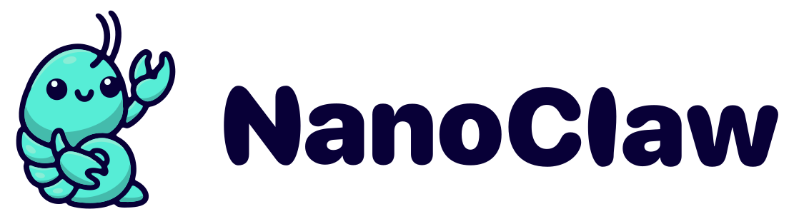
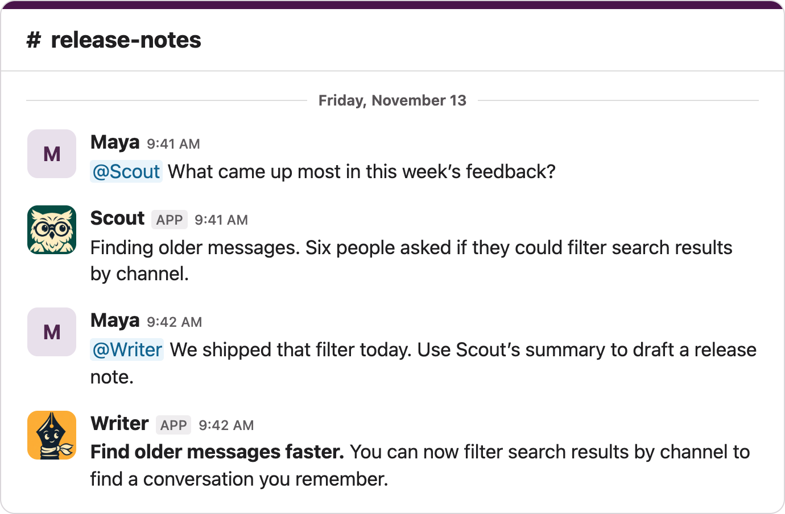

<p align="center">
  <picture>
    <source media="(prefers-color-scheme: dark)" srcset="assets/nanoclaw-logo-dark.svg">
    
  </picture>
</p>

<h1 align="center">The always-on agent you own.</h1>

<p align="center">
  Self-hosted, open source, and small enough to read. Each agent runs in its own container on your machine, on the harness you choose.
</p>

<p align="center"><strong><a href="#quick-start">🚀 Quick start</a></strong> &nbsp;·&nbsp; <strong><a href="https://docs.nanoclaw.dev">📚 Documentation</a></strong> &nbsp;·&nbsp; <a href="#usage">💬 Examples</a> &nbsp;·&nbsp; <a href="#what-it-supports">🔌 Channels</a></p>

<a name="the-always-on-agent-you-own"></a>

## 🩵 Why NanoClaw?

- **It runs on your machine or your server.** One host process, plus a container per agent session. Nothing to sign up for.
- **You can read it and change it.** MIT-licensed, and small enough that a coding agent can walk you through all of it. Your fork is your product.
- **You pick the harness and the model.** Claude Code, Codex, Cursor or OpenCode, each running the vendor's own agent harness, not a reimplementation. Or point it at a local model.
- **Your credentials stay in a gateway you run.** Agents never hold raw API keys.

Self-hosted doesn't mean nothing leaves your machine. Your messages still go to the model provider you choose, unless you run a local model. [What leaves your machine](#accounts-and-what-leaves-your-machine) has the full list.

<details>
<summary>Why we built NanoClaw</summary>

> [OpenClaw](https://github.com/openclaw/openclaw) is an impressive project, but I wouldn't have been able to sleep if I had given complex software I didn't understand full access to my life. OpenClaw has nearly half a million lines of code, 53 config files, and 70+ dependencies. Its security is at the application level (allowlists, pairing codes) rather than true OS-level isolation. Everything runs in one Node process with shared memory.
>
> NanoClaw provides that same core functionality, but in a codebase small enough to understand: one process and a handful of files. Agents run in their own Linux containers with filesystem isolation, not merely behind permission checks.

— Gavriel Cohen, creator of NanoClaw and now CEO of NanoCo, writing in February 2026

[Read Gavriel’s account of the weekend he built NanoClaw in TechCrunch.](https://techcrunch.com/2026/03/13/the-wild-six-weeks-for-nanoclaws-creator-that-led-to-a-deal-with-docker/)

</details>

<a name="requirements"></a>

## 📋 Requirements

- **System:** macOS, Linux, or Windows with WSL2. The commands below use Git and Bash.
- **Containers:** Docker Desktop on macOS or Windows, or Docker Engine on Linux.
- **Runtime:** Node.js 22.23.4+, 24.22.1+, or 26.12.1+, pnpm 10+, and jq. Setup installs or updates Node.js and pnpm and adds jq if needed.
- **Coding agent:** Use a coding agent such as Claude Code, Codex, Cursor, or OpenCode on the host to customize NanoClaw, debug issues, or add skills.

> [!TIP]
> Unsure whether you’re ready to install? Paste this prompt into your coding agent on the computer where you’ll run NanoClaw.
>
> ```text
> I want to install NanoClaw, a self-hosted assistant that runs agents in containers and connects them to messaging apps. The official repository is https://github.com/nanocoai/nanoclaw. Check whether this computer is ready to run its setup script, nanoclaw.sh. Use read-only checks.
>
> Read the requirements for my checkout, or use https://docs.nanoclaw.dev/installation if I haven’t cloned it yet. Check the OS (including WSL2 on Windows), Git, Bash, Node.js, pnpm, and jq. Check whether Docker is installed and whether my user can reach its daemon.
>
> Tell me whether I’m ready to run setup, what the installer will handle, and what I need to fix first. Give the smallest next step for each blocker. Flag anything you couldn’t verify.
> ```

<a name="quick-start"></a>

## 🚀 Quick Start

```bash
git clone https://github.com/nanocoai/nanoclaw.git
cd nanoclaw
bash nanoclaw.sh
```

The [setup wizard](https://docs.nanoclaw.dev/quickstart) prepares your machine, connects a model provider, and pairs your first channel. Try a reminder using your agent’s name.

```text
@Scout remind me every Friday at 4pm to write my weekly update
```

[More usage examples](#usage) · [Installation details](https://docs.nanoclaw.dev/installation)

**Release channels.** The clone above follows the repository’s default branch. For the latest stable version, see [Latest release](https://github.com/nanocoai/nanoclaw/releases/latest). Beta and release candidate builds appear under [Releases](https://github.com/nanocoai/nanoclaw/releases) when available. Check out a specific release tag to pin your install.

<details>
<summary><strong>Migrating from NanoClaw v1?</strong></summary>

Run from a fresh v2 checkout next to your v1 install:

```bash
git clone https://github.com/nanocoai/nanoclaw.git nanoclaw-migration
cd nanoclaw-migration
bash migrate-v2.sh
```

`migrate-v2.sh` finds your v1 install (sibling directory, or `NANOCLAW_V1_PATH=/path/to/nanoclaw`), migrates state into the v2 checkout, then `exec`s into Claude Code to finish the parts that need judgment (owner seeding, shared-memory migration, fork-customisation replay).

Run the script directly, not from inside a coding-agent session — the deterministic side needs interactive prompts and real shell I/O for Node/pnpm bootstrap, Docker, the credential gateway, and the container build.

**What it does:** merges `.env`, seeds the v2 DB from `registered_groups`, copies group folders + session data + scheduled tasks, installs the channel adapters you select, copies channel auth state (including the Baileys keystore for WhatsApp — LID mapping is now resolved per-message by the Baileys v7 adapter, not migrated), builds the agent container.

**What it doesn't:** flip the system service. Pick *"switch to v2"* at the prompt, or do it manually after testing — your v1 install is left untouched.

See [docs/v1-to-v2-changes.md](docs/v1-to-v2-changes.md) for what's different and [docs/migration-dev.md](docs/migration-dev.md) for development notes.

</details>

<a name="philosophy"></a>

## 🧭 Philosophy

Customize your fork to fit how you work. Start with an agent’s instructions or model using the [agent customization guide](https://docs.nanoclaw.dev/guides/customize-an-agent).

When you need another channel or provider, add it with a skill such as `/add-telegram` or `/add-codex`. [How skills extend NanoClaw](https://docs.nanoclaw.dev/extend/overview) explains what gets copied into your checkout.

<a name="what-it-supports"></a>

## 🔌 What It Supports

- **Multi-channel messaging** — WhatsApp (personal or Business Cloud API), Telegram, Discord, Slack, Microsoft Teams, iMessage, Signal, Matrix, Mattermost, Google Chat, Webex, Linear, GitHub, WeChat, DeltaChat, Emacs, phone and SMS via Dial, and email via Resend. Installed on demand with `/add-<channel>` skills. Run one or many at the same time.
- **Flexible isolation** — connect each channel to its own agent for full privacy, share one agent across many channels for unified memory with separate conversations, or fold multiple channels into a single shared session so one conversation spans many surfaces. Pick per channel via `/manage-channels`. See [docs/isolation-model.md](docs/isolation-model.md).
- **Per-agent workspace** — each agent group has its own instructions, its own memory, its own container, and only the mounts you allow. Nothing crosses the boundary unless you wire it to.
- **Scheduled tasks**: recurring jobs executed by the agent, with optional [script gates](docs/scheduled-tasks.md) that avoid waking it when there is no work
- **Web access** — search and fetch content from the web
- **Container isolation** — agents are sandboxed in Docker containers (macOS/Linux/WSL2)
- **Credential security** — agents never hold raw API keys. Outbound requests route through a credential gateway that injects credentials at request time and can enforce per-agent policies and rate limits. Which gateway is yours to pick: setup installs one behind a provider seam ([OneCLI's Agent Vault](https://github.com/onecli/onecli) by default, Iron Proxy as the alternative).
- **Agent templates**: stamp a ready-to-run agent (instructions + MCP tools + skills, no secrets) from a reusable bundle via `ncl groups create --template <ref>`. Templates load from the local `templates/` folder; populate it by hand or by copying from the [public library](https://github.com/nanocoai/nanoclaw-templates). See [docs/templates.md](docs/templates.md).

<a name="accounts-and-what-leaves-your-machine"></a>

## 🔒 Accounts and what leaves your machine

You can build and run NanoClaw locally without a NanoClaw account. Your model provider sees what your agents read and write, and each channel you connect sees the messages sent through it.

You can also [fetch a prebuilt agent image](docs/hardened-image.md) instead of
building it locally. Fetching ours needs a free account, so we see your email address and when
you ask for an image — nothing about your agents, and nothing after the image lands. Building
locally needs no account and contacts nothing, and is the default. The same account unlocks the
[perks](#perks) below.

<a name="telemetry"></a>

## 📊 Telemetry

**Setup diagnostics.** NanoClaw sends setup diagnostics to PostHog. These include which
install steps ran, how long they took, whether they worked (with the error message when setup
stops), and basic platform details like OS and Node version. Reports carry a random per-install ID stored in `data/install-id`.

To turn off setup diagnostics, run this in your shell before starting the installer.

```bash
export NANOCLAW_NO_DIAGNOSTICS=1
```

**README page views.** This README on GitHub loads a [Scarf](https://scarf.sh) pixel that counts page views.

<a name="perks"></a>

## 🎁 Perks

The free account also opens the **community portal** at [portal.nanoclaw.dev](https://portal.nanoclaw.dev),
a dashboard where you switch on what the account offers. Today that is Echo's hardened agent
image and a managed Slack app for your agent, created and installed for you with no tokens to
paste. Everything else in NanoClaw works without it.

Setup opens the portal once. You sign in in the browser, approve the terminal you are running
setup from, and enable the perk; the wizard notices and continues on its own. Enabling Echo is
where you agree to Echo's terms, including whether you want product and security email. Close
the page without enabling anything and setup carries on without the perk, then offers it once
more later.

What stays on your machine: the sign-in record and install token in `~/.config/nanoclaw/account.json`,
one device key per machine in `~/.config/nanoclaw/device-key.json`, and this checkout's journal in
`data/community-portal.json` (which perks are on, setup progress, the credentials a perk handed
you), all mode `0600`. The install token never passes through the browser: the browser sees only
the one-time sign-in code, and the token reaches this machine from the account service directly.
The host keeps one outbound connection to the portal so a perk you change in the browser reaches
the running agent; it sends nothing about your agents, messages or files.

Revisit a step with `pnpm exec tsx setup/portal.ts --stage echo` or `--stage slack`. To sign a
machine out, forget it under **Devices** in the portal: its token stops working and the host
disconnects. Files, recovery commands and troubleshooting: [docs/community-portal.md](docs/community-portal.md).

<a name="usage"></a>

## 💬 Usage

These examples use an agent named Scout. If your channel requires a mention, mention your own agent.

```
@Scout send an overview of the sales pipeline every weekday morning at 9am (has access to my Obsidian vault folder)
@Scout review the git history for the past week each Friday and update the README if there's drift
@Scout every Monday at 8am, compile news on AI developments from Hacker News and TechCrunch and message me a briefing
```

From a channel you own or administer, you can manage groups and tasks:
```
@Scout list all scheduled tasks across groups
@Scout pause the Monday briefing task
```

### From customer feedback to release notes

In this Slack example, Maya asks Scout what customers requested. Once she confirms the feature shipped, Writer uses Scout’s summary to draft the release note.



[Set up agents in Slack](https://docs.nanoclaw.dev/channels/slack).

<a name="customizing"></a>

## 🛠️ Customizing

NanoClaw avoids configuration sprawl. To make changes, just tell your coding agent what you want:

- "Change the trigger word to @Bob"
- "Remember in the future to make responses shorter and more direct"
- "Add a custom greeting when I say good morning"
- "Store conversation summaries weekly"

Or run `/customize` for guided changes.

The codebase is small enough that a coding agent can safely modify it.

<a name="contributing"></a>

## 🤝 Contributing

**Don't add features. Add skills.**

If you want to add a new channel or agent provider, don't add it to trunk. New channel adapters land on the `channels` branch; a new agent provider keeps its code in its skill's `payload/` folder on `main`. Users install them in their own fork with `/add-<name>` skills, which copy the relevant module(s) into the standard paths, wire the registration, and pin dependencies.

This keeps trunk as pure registry and infra, and every fork stays lean — users get the channels and providers they asked for and nothing else.

<a name="rfs-request-for-skills"></a>

### 💡 RFS (Request for Skills)

No channel or provider skills are currently requested — propose one via an issue.

<a name="architecture"></a>

## 🏗️ Architecture


A single Node host orchestrates per-session agent containers. When a message arrives, the host routes it via the entity model (user → messaging group → agent group → session), writes it to the session's `inbound.db`, and wakes the container. The agent-runner inside the container polls `inbound.db`, runs the agent, and writes responses to `outbound.db`. The host polls `outbound.db` and delivers back through the channel adapter.

Two SQLite files per session, each with exactly one writer — no cross-mount contention, no IPC, no stdin piping. Channels and alternative providers self-register at startup; trunk ships the registry and the Chat SDK bridge, while the adapters themselves are skill-installed per fork.

For the full architecture writeup see [docs/architecture.md](docs/architecture.md); for the three-level isolation model see [docs/isolation-model.md](docs/isolation-model.md).

Key files:
- `src/index.ts` — entry point: DB init, channel adapters, delivery polls, sweep
- `src/router.ts` — inbound routing: messaging group → agent group → session → `inbound.db`
- `src/delivery.ts` — polls `outbound.db`, delivers via adapter, handles system actions
- `src/host-sweep.ts` — 60s sweep: stale detection, due-message wake, recurrence
- `src/session-manager.ts` — resolves sessions, opens `inbound.db` / `outbound.db`
- `src/container-runner.ts` — spawns one container per session, leases the session's gateway contribution
- `src/db/` — central DB (users, roles, agent groups, messaging groups, wiring, migrations)
- `src/channels/` — channel adapter infra (adapters installed via `/add-<channel>` skills)
- `src/providers/` — host-side provider config (`claude` baked in; others via skills)
- `container/agent-runner/` — Bun agent-runner: poll loop, MCP tools, provider abstraction
- `groups/<folder>/` — per-agent-group folder (standing instructions, memory, and the generated project doc and container config)

<a name="faq"></a>

## ❓ FAQ

<a name="why-docker"></a>

### Why Docker?

Docker provides cross-platform support (macOS, Linux and Windows via WSL2) and a mature ecosystem.

<a name="can-i-run-this-on-linux-or-windows"></a>

### Can I run this on Linux or Windows?

Yes. Docker is the default runtime and works on macOS, Linux, and Windows (via WSL2). Just run `bash nanoclaw.sh`.

<a name="is-this-secure"></a>

### Is this secure?

Agents run in containers, not behind application-level permission checks. They can only access explicitly mounted directories. Agents never hold raw API keys — outbound API requests route through the installed credential gateway, which injects authentication at the proxy level and supports rate limits and access policies. Forcing all container traffic through the gateway (egress lockdown) is opt-in: set `NANOCLAW_EGRESS_LOCKDOWN=true`. You should still review what you're running, and you can ask your coding agent to walk you through any part of it. See the [security documentation](https://docs.nanoclaw.dev/concepts/security) for the full security model.

Found a vulnerability? Please don't open a public issue. [SECURITY.md](SECURITY.md) explains how to report it privately.

<a name="why-so-little-configuration"></a>

### Why so little configuration?

We don't want configuration sprawl. Every user should customize NanoClaw so that the code does exactly what they want, rather than configuring a generic system. If you prefer having config files, you can ask your coding agent to add them.

<a name="can-i-use-third-party-or-open-source-models"></a>

### Can I use third-party or open-source models?

Yes. Pick a provider at setup or add one later: `/add-codex` (OpenAI), `/add-cursor`, `/add-opencode` (OpenRouter, OpenAI, Google, DeepSeek, and more via OpenCode config) or `/add-ollama-provider` (local open-weight models via Ollama). All are configurable per agent group, so different agents can run on different backends in the same install.

For local models there are two routes: `/add-opencode` pointed at a local OpenAI-compatible endpoint (any server on your machine or network that speaks the OpenAI API), or `/add-ollama-provider`, which keeps the Claude harness and points it at Ollama.

For one-off experiments with the Claude provider, any Anthropic API-compatible endpoint also works via `.env`:

```bash
ANTHROPIC_BASE_URL=https://your-api-endpoint.com
ANTHROPIC_AUTH_TOKEN=your-token-here
```

<a name="how-do-i-debug-issues"></a>

### How do I debug issues?

Ask your coding agent. "Why isn't the scheduler running?" "What's in the recent logs?" "Why did this message not get a response?" That's the AI-native approach that underlies NanoClaw.

<a name="why-isnt-the-setup-working-for-me"></a>

### Why isn't the setup working for me?

If a step fails, `nanoclaw.sh` offers to hand off to a coding agent to diagnose and resume. If that doesn't resolve it, open your coding agent in the checkout and run `/debug`. If it identifies an issue likely to affect other users, open a PR against the relevant setup step or skill.

<a name="how-do-i-uninstall-nanoclaw"></a>

### How do I uninstall NanoClaw?

```bash
bash nanoclaw.sh --uninstall
```

Every install is tagged with a per-checkout id, so the uninstaller removes only what belongs to that copy: the background service, containers and image, app data and logs, your agents' files, and this copy's gateway agents. Shared things — the gateway service and your credentials, other NanoClaw copies on the machine — are left alone. It shows exactly what it found and asks for confirmation per group; nothing is deleted until you say yes. Use `--dry-run` to preview without changing anything, or `--yes` to skip the prompts. Your `.env` is backed up before removal. To finish, delete the checkout folder itself.

<a name="what-changes-will-be-accepted-into-the-codebase"></a>

### What changes will be accepted into the codebase?

Only security fixes, bug fixes, and clear improvements will be accepted to the base configuration. That's all.

Everything else (new capabilities, OS compatibility, hardware support, enhancements) should be contributed as skills: channel code on the `channels` registry branch, everything else (agent providers included) as a self-contained skill. See [docs/customizing.md](docs/customizing.md) and [CONTRIBUTING.md](CONTRIBUTING.md).

This keeps the base system minimal and lets every user customize their installation without inheriting features they don't want.

<a name="community"></a>

## 👥 Community

Thank you to the [130+ contributors](https://github.com/nanocoai/nanoclaw/graphs/contributors) who have helped build NanoClaw.

[Website](https://nanoclaw.dev) · [Discord](https://discord.gg/VDdww8qS42) · [Repository token count](repo-tokens)

**Read in another language** · [中文](README_zh.md) · [日本語](README_ja.md) · [한국어](README_ko.md)

<a name="changelog"></a>

## 📝 Changelog

See [CHANGELOG.md](CHANGELOG.md) for breaking changes, or the [full release history](https://docs.nanoclaw.dev/changelog) on the documentation site.

<a name="license"></a>

## 📄 License

[MIT License](LICENSE)


