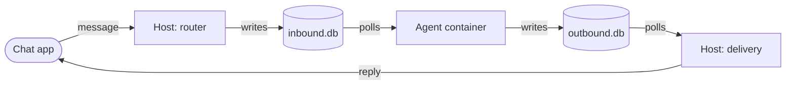

<p align="center">
  <picture>
    <source media="(prefers-color-scheme: dark)" srcset="assets/nanoclaw-logo-dark.png">
    
  </picture>
</p>

<p align="center">
  NanoClaw is an AI assistant you run on your own machine and message from Slack, Telegram, Discord, WhatsApp, and other chat apps. Agents run in their own containers. The code is small enough to read and change.
</p>

<p align="center">
  <a href="https://nanoclaw.dev">nanoclaw.dev</a>&nbsp; • &nbsp;
  <a href="https://docs.nanoclaw.dev">docs</a>&nbsp; • &nbsp;
  <a href="README_zh.md">中文</a>&nbsp; • &nbsp;
  <a href="README_ja.md">日本語</a>&nbsp; • &nbsp;
  <a href="README_ko.md">한국어</a>&nbsp; • &nbsp;
  <a href="https://discord.gg/VDdww8qS42"></a>&nbsp; • &nbsp;
  <a href="repo-tokens"></a>
</p>

---

## Why NanoClaw

From Gavriel Cohen, who created NanoClaw, at the start of the project:

> [OpenClaw](https://github.com/openclaw/openclaw) is an impressive project, but I wouldn't have been able to sleep if I had given complex software I didn't understand full access to my life. OpenClaw has nearly half a million lines of code, 53 config files, and 70+ dependencies. Its security is at the application level (allowlists, pairing codes) rather than true OS-level isolation. Everything runs in one Node process with shared memory.

NanoClaw provides that same core functionality in a codebase small enough to understand: one host process, and code a coding agent can read in one pass. Agents run in their own Linux containers with filesystem isolation, not merely behind permission checks.

## Quick start

> [!IMPORTANT]
> You need macOS or Linux (on Windows, run inside WSL2), git, about 4 GB of RAM, and an account with a model provider such as Claude. Setup installs Node, pnpm, jq, and Docker if they are missing.

```bash
git clone https://github.com/nanocoai/nanoclaw.git
cd nanoclaw
bash nanoclaw.sh
```

`nanoclaw.sh` takes a fresh machine to an agent you can message. Along the way it:

- checks your machine and installs what is missing (on macOS it uses Homebrew, and offers to install it; on Linux it asks for your password for `sudo`)
- builds the agent's container image, or fetches a prebuilt hardened one if you sign in to a free NanoClaw account
- installs a credential gateway and stores your model sign-in there, so agents never see it
- lets you pick the agent runtime: Claude (built in), or Codex, Cursor, or OpenCode
- starts the background service, checks that a test agent replies, and offers to connect a chat app or chat from the terminal

If a step fails, setup can hand it to Claude Code (or your runtime's own helper) to diagnose and retry. A failure before Claude is set up just stops; run `bash nanoclaw.sh` again to carry on.

When setup finishes, message your agent in the chat app you connected, or in the terminal if you chose that:

```bash
pnpm run chat hi            # talk to your terminal agent
tail -f logs/nanoclaw.log   # watch what the host is doing
```

To update later, run `/update-nanoclaw` in a coding agent ([Upgrading](https://docs.nanoclaw.dev/operate/upgrading)). The clone gives you the newest code on `main`, so the first time you update, it asks whether to stay on `main` or follow releases.

See the step-by-step [Quickstart](https://docs.nanoclaw.dev/quickstart), including Windows.

<details>
<summary><strong>Full requirements</strong></summary>

- macOS or Linux (Windows through WSL2), and git (setup does not install it)
- About 4 GB of RAM or more (setup warns below that)
- Node.js 22.23.4+, 24.22.1+, or 26.12.1+, and pnpm 10 (setup installs them if missing: Node through Homebrew on macOS or NodeSource on Debian and Ubuntu)
- jq, which the channel skills use (setup installs it if missing)
- [Docker Desktop](https://docker.com/products/docker-desktop) (macOS, Windows) or Docker Engine (Linux); setup can install it
- An account with your model provider: Claude (subscription or API key), or the provider you add
- [Claude Code](https://claude.ai/download) is optional. Setup installs it when you choose Claude subscription sign-in or ask it to diagnose a failure. Skills that setup doesn't run for you (`/customize`, `/debug`, most `/add-<name>`) run inside a coding agent.

</details>

<details>
<summary><strong>Migrating from NanoClaw v1?</strong></summary>

Clone v2 next to your v1 folder and run the migration from a real terminal, not from inside a Claude session:

```bash
git clone https://github.com/nanocoai/nanoclaw.git nanoclaw-v2
cd nanoclaw-v2
bash migrate-v2.sh
```

`migrate-v2.sh` only reads your v1 files. It:

1. Finds v1 in a sibling folder. To point it elsewhere, set `NANOCLAW_V1_PATH=/path/to/nanoclaw`.
2. Merges `.env`, seeds the v2 database from `registered_groups`, and copies group folders, session data, scheduled tasks, and channel sign-ins (including the WhatsApp keystore).
3. Installs the credential gateway and builds the agent container.
4. If your v1 service is running, asks before switching. On yes, it stops v1, starts v2, and lets you keep v2 or switch back.
5. If you keep v2, or v1 wasn't running, stops the v1 service and keeps its service file for rollback. On macOS that file still starts v1 at your next login, so move `~/Library/LaunchAgents/com.nanoclaw.plist` out of that folder once you're happy with v2.
6. Opens Claude Code to finish the parts that need judgment (owner seeding, shared memory, fork changes). If Claude Code is not installed, it tells you to run `/migrate-from-v1`.

See the [Migrate from v1](https://docs.nanoclaw.dev/migrate-from-v1) guide, [docs/v1-to-v2-changes.md](docs/v1-to-v2-changes.md), and [docs/migration-dev.md](docs/migration-dev.md).

</details>

## What it supports

- **Chat apps.** A built-in terminal chat, plus a skill for each chat app (list below). Setup's menu connects nine of them; the rest install with `/add-<channel>`. Run one or many at once.
- **One Slack app per agent.** With a free NanoClaw account, setup creates each agent's own Slack app (manifest, avatar, and workspace install), so there are no tokens to paste. Teammates you spawn from chat get their own bot and memory too.
- **Agent runtimes.** Claude is built in, through Anthropic's Claude Agent SDK with Claude Code's full toolset. Codex, Cursor, and OpenCode install as skills (`/add-codex`, `/add-cursor`, `/add-opencode`). Each agent group picks its own. An agent group is one agent with its own folder, memory, and settings.
- **Credential gateways.** Agents never hold your keys. A gateway outside the container adds credentials to outbound requests and can hold a request until you approve it in chat. Setup installs OneCLI by default; Iron Proxy is the other choice under **Advanced**. Both are skills behind one gateway seam. See [Gateways](https://docs.nanoclaw.dev/operate/gateways).
- **Isolation you choose.** Each session runs in its own container with only the mounts you allow (`/manage-mounts`). Give each chat its own agent, share one agent across chats, or share one conversation across chats (`/manage-channels`). See [Isolation levels](https://docs.nanoclaw.dev/concepts/isolation-levels).
- **Scheduled tasks.** One-off or recurring jobs, with optional [gate scripts](https://docs.nanoclaw.dev/guides/scheduled-tasks) that skip waking the agent when there is no work.
- **Web access.** Search and fetch, plus a headless Chromium browser in the agent image.
- **Agent templates.** `ncl groups create --template <ref>` stamps a ready-to-run agent (instructions, MCP tools, and skills, no secrets) from the local `templates/` folder. Setup, and an agent creating another agent, can also fetch one from the [public library](https://github.com/nanocoai/nanoclaw-templates). See [Templates](https://docs.nanoclaw.dev/templates/overview).

<details>
<summary><strong>All chat apps</strong></summary>

| Chat app | Skill | In setup's menu |
|---|---|---|
| Slack | `/add-slack` | ✓ |
| Microsoft Teams | `/add-teams` | ✓ |
| Telegram | `/add-telegram` | ✓ |
| Discord | `/add-discord` | ✓ |
| WhatsApp (linked device) | `/add-whatsapp` | ✓ |
| Signal | `/add-signal` | ✓ |
| iMessage | `/add-imessage` | ✓ |
| Mattermost | `/add-mattermost` | ✓ |
| Dial (phone calls and SMS) | `/add-dial` | ✓ |
| WhatsApp Cloud API | `/add-whatsapp-cloud` | |
| Matrix | `/add-matrix` | |
| Google Chat | `/add-gchat` | |
| Webex | `/add-webex` | |
| WeChat | `/add-wechat` | |
| Delta Chat | `/add-deltachat` | |
| Email via Resend | `/add-resend` | |
| GitHub | `/add-github` | |
| Linear | `/add-linear` | |
| Emacs | `/add-emacs` | |

</details>

## Philosophy

**Small enough to understand.** One host process and no microservices of its own. Ask your coding agent to walk you through the code.

**Secure by isolation.** Agents run in Linux containers and see only what you mount. Bash is safe because commands run inside the container, not on your host.

**Yours to change.** NanoClaw is not a big framework. You fork it and have a coding agent change the code to fit you. A few settings live in `.env` and in `ncl`; the rest is code.

**Skills over features.** Core does not ship every chat app or model. You add the ones you want with a skill, a command such as `/add-telegram` that you run in a coding agent. It copies that code into your checkout.

## Accounts and what leaves your machine

> [!NOTE]
> NanoClaw works without an account.

- **Setup diagnostics.** Setup sends anonymous events (which steps ran, how they ended, your platform) to PostHog under a random install id. To turn them off, run `export NANOCLAW_NO_DIAGNOSTICS=1` before `bash nanoclaw.sh`.
- **Your model and chat apps.** Your messages and files go to the model provider and chat apps you connect, not to NanoClaw.
- **Optional free account.** Signing in to the [community portal](https://portal.nanoclaw.dev) switches on perks: Echo's prebuilt hardened agent image (Claude runtime only) and a managed Slack app for each agent. Setup asks before each one, then opens the portal in your browser.

What the account sends:

- your email address, a random host id, your OS and CPU type, your NanoClaw version, and a device label
- for the Slack perk, also the agent's name, your workspace, your Slack user id, and up to 300 characters of the agent's instructions to draw its avatar
- nothing about your messages or files

See [docs/community-portal.md](docs/community-portal.md#what-the-account-sends) for the full list, file locations, and how to sign out.

## Usage

Message your agent in a direct message, or @mention its bot in a group. When you connect a chat app, setup asks what to call the agent (default: Nano).

Ask in plain words:

```
Send me an overview of the sales pipeline every weekday at 9am
Every Monday at 8am, compile AI news from Hacker News and TechCrunch and send me a briefing
Pause the Monday briefing
```

On the host, `ncl` manages groups, tasks, wirings, and roles:

```bash
ncl status
ncl groups list
ncl tasks list
```

Setup links `ncl` into `~/.local/bin`. If that folder isn't on your PATH, run it from the checkout instead: `pnpm run ncl status`. See the [ncl reference](https://docs.nanoclaw.dev/reference/ncl-cli).

**Give an agent a folder** (say, an Obsidian vault). Allow the folder with `/manage-mounts`, then run:

```bash
ncl groups config add-mount --id <group-id> --host <path> --container <name>
ncl groups restart --id <group-id>
```

The agent sees it at `/workspace/extra/<name>`. `<name>` is a short name, not a full path. Find the group id with `ncl groups list`.

**Add the agent to another chat.** Invite its bot there and mention it. On most apps you then get a card to connect it, start a new agent for that chat, or reject it. If no card appears (for example WhatsApp on a shared number), run `/manage-channels`.

## Customizing

There are two places to change things:

- **In chat, with your agent:** standing instructions ("keep replies short", "add a custom greeting when I say good morning"), memory, and recurring tasks ("store conversation summaries weekly"). Agents can also ask to install packages or add MCP servers; an admin approves each request.
- **In code, with a coding agent:** open the checkout in Claude Code, Codex, or another coding agent (`AGENTS.md` and `.agents/skills` point at the same files as `CLAUDE.md` and `.claude/skills`) and say what you want. Run `/customize` for guided changes.

Settings that aren't code live in `.env` and in the database through `ncl`, for example `ncl groups config update --id <group-id> --provider codex`. See [Customize an agent](https://docs.nanoclaw.dev/guides/customize-an-agent).

## Contributing

**Don't add features. Add skills.**

Core accepts bug fixes, security fixes, simplifications, and less code. New channels, providers, gateways, and tools ship as skills:

- channel adapters land on the `channels` branch
- providers and gateways keep their code in the skill's `payload/` folder
- tools keep theirs in the skill folder itself

Users install them in their own fork with `/add-<name>`, which copies the code into place, wires the registration, and pins dependencies.

Before you open a PR, read [CONTRIBUTING.md](CONTRIBUTING.md) and run:

```bash
pnpm test
pnpm run lint
pnpm run typecheck
```

See also [Contributing](https://docs.nanoclaw.dev/concepts/contributing) and [Writing skills](https://docs.nanoclaw.dev/extend/writing-skills) on the docs site.

Want a skill that doesn't exist yet? Search the open issues, then open a [capability or skill request](https://github.com/nanocoai/nanoclaw/issues/new?template=capability-request.yml).

## Architecture



1. One Node host process routes each incoming message from its messaging group to every wired agent group, and from there to a session.
2. The host writes the message to that session's `inbound.db` and wakes its container.
3. The agent runner (Bun) inside the container polls `inbound.db`, runs the agent, and writes replies to `outbound.db`.
4. The host polls `outbound.db` and delivers the replies.

Each file has exactly one writer: no IPC, no stdin piping.

Core is registries and seams. Channels, agent providers, credential gateways, the container runtime (Docker today), and the session mailbox all self-register at startup, and skills add more.

| Path | What's there |
|---|---|
| `src/` | The host: routing (`router.ts`), delivery (`delivery.ts`), sessions and containers (`session-manager.ts`, `container-runner.ts`), the 60-second sweep (`host-sweep.ts`), the central DB (`db/`), and `ncl` (`cli/`) |
| `src/channels/`, `src/providers/`, `src/gateway-providers/`, `src/drivers/` | The seams (the terminal channel and Claude are built in) |
| `container/agent-runner/` | The Bun agent runner: poll loop, MCP tools, providers |
| `setup/` | The install wizard |
| `groups/<folder>/` | Each agent group's files: memory and `instructions.prepend.md`. The agent's `CLAUDE.md` (`AGENTS.md` for Codex and Cursor) is rebuilt at every container start |
| `.claude/skills/` | Skills |

See [Architecture](https://docs.nanoclaw.dev/concepts/architecture).

## FAQ

<details>
<summary><strong>Is this secure?</strong></summary>

Agents run in containers and see only what you mount. On top of that:

- The container's environment is built from scratch: `.env` is not passed in, and credential-shaped values are refused.
- Outbound API calls go through the installed credential gateway. It adds credentials outside the container and can hold a request until you approve it.
- Keep keys in the gateway, not in an MCP server's `--env`. Those values land in the agent's own config, where it can read them.
- For a hard network fence, set `NANOCLAW_EGRESS_LOCKDOWN=true` so the gateway is the only way out. Iron Proxy setup turns it on.

You should still review what you run, and the codebase is small enough that you can. See the [security model](docs/SECURITY.md).

</details>

<details>
<summary><strong>Why Docker?</strong></summary>

It works the same on macOS, Linux, and Windows (WSL2), with a mature ecosystem. Docker is the only container runtime that ships today; the runtime sits behind a driver seam.

</details>

<details>
<summary><strong>Can I use other models?</strong></summary>

Yes:

- **Other runtimes.** Add a skill (`/add-opencode` for OpenRouter, OpenAI, Google, DeepSeek, and more; `/add-codex`; `/add-cursor`) and pick it per agent group.
- **Any Claude API-compatible endpoint.** Choose **Advanced** in setup and fill in *Anthropic API base URL* and *Anthropic auth token*. The token is stored in the gateway, not in `.env`.

</details>

<details>
<summary><strong>How do I debug issues?</strong></summary>

Ask your coding agent in the checkout: "Why isn't the scheduler running?" "What's in the recent logs?" "Why did this message not get a response?" Or run `/debug`. See [Troubleshooting](https://docs.nanoclaw.dev/operate/troubleshooting).

</details>

<details>
<summary><strong>Why isn't setup working for me?</strong></summary>

When a step fails, setup can hand it to Claude Code to diagnose and retry. Running `bash nanoclaw.sh` again is safe: it keeps your install and carries on. Still stuck? Run `/debug` in your coding agent. If you find an issue likely to affect other users, open a PR against the setup step or skill.

</details>

<details>
<summary><strong>How do I uninstall NanoClaw?</strong></summary>

```bash
bash nanoclaw.sh --uninstall
```

- **Removes** only what belongs to this copy: the background service, containers and image, app data and logs, your agents' files, and gateway services labelled with this copy's id, with any credentials stored in them.
- **Keeps** a gateway installed for the whole machine, such as OneCLI's default in `~/.onecli`, with its credentials.
- **Asks** before each group. Use `--dry-run` to preview or `--yes` to skip the prompts.
- **Backs up** your `.env` inside the folder. Copy the backup out before you delete the folder.

See [Uninstall](https://docs.nanoclaw.dev/operate/uninstall).

</details>

## Community

Questions? Ideas? [Join the Discord](https://discord.gg/VDdww8qS42) or ask in [GitHub Discussions](https://github.com/nanocoai/nanoclaw/discussions).

## Security

Found a vulnerability? [Report it privately](https://github.com/nanocoai/nanoclaw/security/advisories/new), not in a public issue. See [SECURITY.md](SECURITY.md).

## Changelog

Releases use calendar versions (`vYYYY.MM.N`, for example `v2026.10.0`). See [CHANGELOG.md](CHANGELOG.md), including each release's *Before you update* notes, or the [full release history](https://docs.nanoclaw.dev/changelog) on the documentation site.

## License

[MIT](LICENSE)


