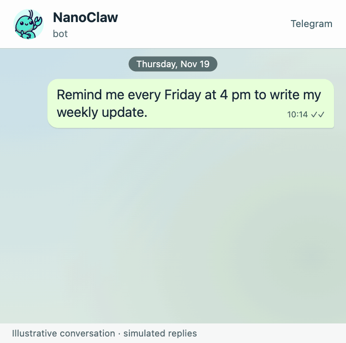
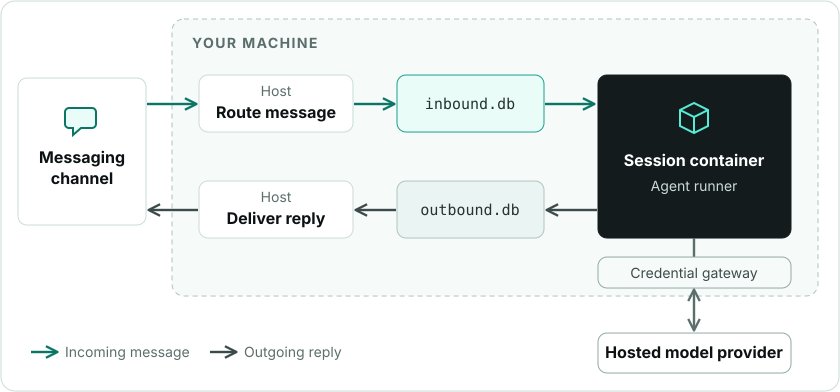

<p align="center">
  <picture>
    <source media="(prefers-color-scheme: dark)" srcset="https://raw.githubusercontent.com/nanocoai/nanoclaw-brand-kit/v1.3.1/assets/logo/nanoclaw-logo-dark.svg">
    
  </picture>
</p>

<a name="the-always-on-agent-you-own"></a>

<h1 align="center">The always-on agent you own.</h1>

<p align="center">
  An open-source assistant you run on your own machine. Message your agent from the apps you already use.
</p>

<p align="center"><strong><a href="#quick-start">🚀 Quick start</a></strong> &nbsp;·&nbsp; <strong><a href="https://docs.nanoclaw.dev">📚 Documentation</a></strong> &nbsp;·&nbsp; <a href="#usage">💬 Examples</a> &nbsp;·&nbsp; <a href="#what-it-supports">🔌 Channels</a></p>

---

## 🩵 Why NanoClaw?

- **You run it.** NanoClaw runs on your computer or server. Each agent session runs in a container, an isolated environment on that machine.
- **You can change it.** The code is MIT-licensed. Ask your coding agent to walk you through a feature or change it in your fork.
- **You choose how your agent runs.** Use Claude Code, Codex, Cursor, or OpenCode. You can also connect a local model.
- **You control your API keys.** A credential gateway on your machine adds the key when it forwards a request.

If you use a hosted model, its provider receives the content your agent sends in a request. See [what leaves your machine](#accounts-and-what-leaves-your-machine).

<details>
<summary>Why we built NanoClaw</summary>

> [OpenClaw](https://github.com/openclaw/openclaw) is an impressive project, but I wouldn't have been able to sleep if I had given complex software I didn't understand full access to my life. OpenClaw has nearly half a million lines of code, 53 config files, and 70+ dependencies. Its security is at the application level (allowlists, pairing codes) rather than true OS-level isolation. Everything runs in one Node process with shared memory.
>
> NanoClaw provides that same core functionality, but in a codebase small enough to understand: one process and a handful of files. Agents run in their own Linux containers with filesystem isolation, not merely behind permission checks.

— Gavriel Cohen, creator of NanoClaw and now CEO of NanoCo, writing in February 2026

[Read Gavriel's account of the weekend he built NanoClaw in TechCrunch.](https://techcrunch.com/2026/03/13/the-wild-six-weeks-for-nanoclaws-creator-that-led-to-a-deal-with-docker/)

</details>

<a name="requirements"></a>
<a name="can-i-run-this-on-linux-or-windows"></a>
<a name="why-docker"></a>

## 📋 Requirements

- **System:** macOS, Linux, or Windows with WSL2. Setup is the same on all three: `bash nanoclaw.sh`. The commands below use Git and Bash.
- **Containers:** Docker Desktop on macOS or Windows, or Docker Engine on Linux. Docker is the default runtime on all three, for its cross-platform support and mature ecosystem.
- **Runtime:** Node.js 22.23.4+, 24.22.1+, or 26.12.1+, pnpm 10+, and jq. Setup installs or updates Node.js and pnpm and adds jq if needed.
- **Coding agent (recommended):** Use a coding agent such as Claude Code, Codex, Cursor, or OpenCode on the host to customize NanoClaw, debug issues, or add skills.

> [!TIP]
> Unsure whether you're ready to install? Paste this prompt into your coding agent on the computer where you'll run NanoClaw.
>
> ```text
> I want to install NanoClaw, a self-hosted assistant that runs agents in containers and connects them to messaging apps. The official repository is https://github.com/nanocoai/nanoclaw. Check whether this computer is ready to run its setup script, nanoclaw.sh. Use read-only checks.
>
> Read the requirements for my checkout, or use https://docs.nanoclaw.dev/installation if I haven't cloned it yet. Check the OS (including WSL2 on Windows), Git, Bash, Node.js, pnpm, and jq. Check whether Docker is installed and whether my user can reach its daemon.
>
> Tell me whether I'm ready to run setup, what the installer will handle, and what I need to fix first. Give the smallest next step for each blocker. Flag anything you couldn't verify.
> ```

<a name="quick-start"></a>

## 🚀 Quick Start

```bash
git clone https://github.com/nanocoai/nanoclaw.git
cd nanoclaw
bash nanoclaw.sh
```

The [setup wizard](https://docs.nanoclaw.dev/quickstart) prepares your machine, connects a model provider, and pairs your first channel. Once paired, send your agent a reminder. If your channel requires a mention, add your agent's name first.

```text
Remind me every Friday at 4pm to write my weekly update.
```

[More usage examples](#usage) · [Installation details](https://docs.nanoclaw.dev/installation)

**Release channels.** The clone above follows the repository's default branch. For the latest stable version, see [Latest release](https://github.com/nanocoai/nanoclaw/releases/latest). Beta and release candidate builds appear under [Releases](https://github.com/nanocoai/nanoclaw/releases) when available. Check out a specific release tag to pin your install.

<details>
<summary><strong>Migrating from NanoClaw v1?</strong></summary>

Run from a fresh v2 checkout next to your v1 install:

```bash
git clone https://github.com/nanocoai/nanoclaw.git nanoclaw-migration
cd nanoclaw-migration
bash migrate-v2.sh
```

`migrate-v2.sh` finds your v1 install (sibling directory, or `NANOCLAW_V1_PATH=/path/to/nanoclaw`), migrates state into the v2 checkout, then `exec`s into Claude Code to finish the parts that need judgment (owner seeding, shared-memory migration, fork-customization replay).

Run the script directly, not from inside a coding-agent session — the deterministic side needs interactive prompts and real shell I/O for Node/pnpm bootstrap, Docker, the credential gateway, and the container build.

**What it does:** merges `.env`, seeds the v2 DB from `registered_groups`, copies group folders + session data + scheduled tasks, installs the channel adapters you select, copies channel auth state (including the Baileys keystore for WhatsApp — LID mapping is now resolved per-message by the Baileys v7 adapter, not migrated), builds the agent container.

**What it doesn't:** flip the system service. Pick *"switch to v2"* at the prompt, or do it manually after testing — your v1 install is left untouched.

See [docs/v1-to-v2-changes.md](docs/v1-to-v2-changes.md) for what's different and [docs/migration-dev.md](docs/migration-dev.md) for development notes.

</details>

<a name="usage"></a>

## 💬 Usage

Send a request in your own words. In channels that require a mention, start with your agent's name.

<picture>
  <source media="(prefers-reduced-motion: reduce)" srcset="assets/telegram-reminder-still.png">
  
</picture>

### From customer feedback to release notes

In this Slack example, Maya asks Scout what customers requested. Once she confirms the feature shipped, Writer uses Scout's summary to draft the release note.


[Set up agents in Slack](https://docs.nanoclaw.dev/channels/slack).

<a name="philosophy"></a>
<a name="customizing"></a>

## 🛠️ Customizing

Tell your coding agent what you want to change in your fork. For example:

- "Change the trigger word to @Bob"
- "Remember in the future to make responses shorter and more direct"
- "Add a custom greeting when I say good morning"
- "Store conversation summaries weekly"

Run `/customize` for a guided change. To adjust instructions or switch models, see [Customize an agent](https://docs.nanoclaw.dev/guides/customize-an-agent).

When you need another channel or provider, add it with a skill such as `/add-telegram` or `/add-codex`. [How skills extend NanoClaw](https://docs.nanoclaw.dev/extend/overview) explains what gets copied into your checkout.

<a name="what-it-supports"></a>

## 🔌 What It Supports

- **Multi-channel messaging** — WhatsApp (personal or Business Cloud API), Telegram, Discord, Slack, Microsoft Teams, iMessage, Signal, Matrix, Mattermost, Google Chat, Webex, Linear, GitHub, WeChat, DeltaChat, Emacs, phone and SMS via Dial, and email via Resend. Installed on demand with `/add-<channel>` skills. Run one or many at the same time.
- **Conversation sharing** — Give a channel its own agent, share one agent’s memory across separate conversations, or continue the same conversation across channels. Choose with `/manage-channels`. See [how isolation works](docs/isolation-model.md).
- **Per-agent workspace** — each agent group has its own instructions, its own memory, its own container, and only the mounts you allow. Nothing crosses the boundary unless you wire it to.
- **Scheduled tasks** — recurring jobs executed by the agent, with optional [script gates](docs/scheduled-tasks.md) that avoid waking it when there is no work.
- **Web access** — search and fetch content from the web.
- **Container isolation** — one Docker container per agent session (macOS/Linux/WSL2). How it contains an agent: [Is this secure?](#is-this-secure).
- **Credential gateway** — Setup installs [OneCLI’s Agent Vault](https://github.com/onecli/onecli) by default. You can choose Iron Proxy instead. See [how the gateway handles keys](#is-this-secure).
- **Agent templates** — Create an agent with `ncl groups create --template <ref>`. A template bundles instructions, MCP tools, and skills. Keep secrets out of templates. Use a template in `templates/` or copy one from the [public library](https://github.com/nanocoai/nanoclaw-templates). See the [template guide](docs/templates.md).

<a name="accounts-and-what-leaves-your-machine"></a>

## 🔒 Accounts and what leaves your machine

You can build and run NanoClaw without a NanoClaw account. A hosted model provider receives what your agent sends it. Each messaging service you connect receives the messages you send through it.

By default, setup builds the agent image on your machine. If you [download our prebuilt image](docs/hardened-image.md), you need a free account. NanoClaw receives your email address and the time you request the image. The same account gives you access to the optional [community perks](#perks).

<a name="telemetry"></a>

## 📊 Telemetry

**Setup diagnostics.** NanoClaw sends setup diagnostics to PostHog. These include which
install steps ran, how long they took, whether they worked (with the error message when setup
stops), and basic platform details like OS and Node version. Reports carry a random per-install ID stored in `data/install-id`.

To turn off setup diagnostics, run this in your shell before starting the installer.

```bash
export NANOCLAW_NO_DIAGNOSTICS=1
```

**README page views.** This README on GitHub loads a [Scarf](https://scarf.sh) pixel that counts page views.

<a name="perks"></a>

## 🎁 Perks

The free account also opens the **community portal** at [portal.nanoclaw.dev](https://portal.nanoclaw.dev), where you switch on what the account offers: a hardened agent image from [Echo](https://echo.ai), who rebuild the software inside the agent's container from scratch and patch it, and a managed Slack app for your agent, with no tokens to paste.
Setup opens the portal once; everything else in NanoClaw works without it.
The files and tokens kept on your machine, the `--stage` commands to revisit a step, and troubleshooting are in [docs/community-portal.md](docs/community-portal.md).

<a name="contributing"></a>
<a name="what-changes-will-be-accepted-into-the-codebase"></a>

## 🤝 Contributing

**Add new capabilities as skills.**

Only security fixes, bug fixes, and clear improvements will be accepted to the base configuration. Everything else (new capabilities, OS compatibility, hardware support, enhancements) should be contributed as skills.

If you want to add a new channel or agent provider, don't add it to trunk. New channel adapters land on the `channels` branch; a new agent provider keeps its code in its skill's `payload/` folder on `main`. Users install them in their own fork with `/add-<name>` skills, which copy the relevant module(s) into the standard paths, wire the registration, and pin dependencies. See [docs/customizing.md](docs/customizing.md) and [CONTRIBUTING.md](CONTRIBUTING.md).

People can then install the channels and providers they use in their own fork.

<a name="architecture"></a>

## 🏗️ Architecture



When you send a message, the Node.js host finds the right session, writes the message to `inbound.db`, and wakes the container. Inside the container, the agent runner reads the message and writes its reply to `outbound.db`. The host sends the reply back to your channel.

Each session has two SQLite files. Only the host writes incoming messages, and only the agent runner writes replies. Channel adapters and model providers register with the host at startup.

For the full architecture writeup see [docs/architecture.md](docs/architecture.md); for the three-level isolation model see [docs/isolation-model.md](docs/isolation-model.md).

Key files:
- `src/index.ts` — entry point: DB init, channel adapters, delivery polls, sweep
- `src/router.ts` — inbound routing: messaging group → agent group → session → `inbound.db`
- `src/delivery.ts` — polls `outbound.db`, delivers via adapter, handles system actions
- `src/host-sweep.ts` — 60s sweep: stale detection, due-message wake, recurrence
- `src/session-manager.ts` — resolves sessions, opens `inbound.db` / `outbound.db`
- `src/container-runner.ts` — spawns one container per session, leases the session's gateway contribution
- `src/db/` — central DB (users, roles, agent groups, messaging groups, wiring, migrations)
- `src/channels/` — channel adapter infra (adapters installed via `/add-<channel>` skills)
- `src/providers/` — host-side provider config (`claude` baked in; others via skills)
- `container/agent-runner/` — Bun agent-runner: poll loop, MCP tools, provider abstraction
- `groups/<folder>/` — per-agent-group folder (standing instructions, memory, and the generated project doc and container config)

<a name="faq"></a>

## ❓ FAQ

<a name="is-this-secure"></a>

### Is this secure?

Agents run in containers, not behind application-level permission checks. They can only access explicitly mounted directories. Agents never hold raw API keys — outbound API requests route through the installed credential gateway, which injects authentication at the proxy level and supports rate limits and per-agent access policies.

**Egress lockdown is opt-in.** Forcing all container traffic through the gateway is off unless you set `NANOCLAW_EGRESS_LOCKDOWN=true`.

You should still review what you're running, and you can ask your coding agent to walk you through any part of it. See the [security documentation](https://docs.nanoclaw.dev/concepts/security) for the full security model.

Found a vulnerability? Follow the [private reporting instructions](SECURITY.md).

<a name="why-so-little-configuration"></a>

### Why so little configuration?

By design: you change the code itself rather than configure a generic system. See [Customizing](#customizing).

<a name="can-i-use-third-party-or-open-source-models"></a>

### Can I use third-party or open-source models?

Yes. Pick a provider at setup or add one later: `/add-codex` (OpenAI), `/add-cursor`, `/add-opencode` (OpenRouter, OpenAI, Google, DeepSeek, and more via OpenCode config) or `/add-ollama-provider` (local open-weight models via Ollama). All are configurable per agent group, so different agents can run on different backends in the same install.

For local models there are two routes: `/add-opencode` pointed at a local OpenAI-compatible endpoint (any server on your machine or network that speaks the OpenAI API), or `/add-ollama-provider`, which keeps the Claude harness and points it at Ollama.

For one-off experiments with the Claude provider, any Anthropic API-compatible endpoint also works via `.env`:

```bash
ANTHROPIC_BASE_URL=https://your-api-endpoint.com
ANTHROPIC_AUTH_TOKEN=your-token-here
```

<a name="how-do-i-debug-issues"></a>

### How do I debug issues?

Start with one symptom and tell your coding agent what you expected. For example: “My Monday briefing didn’t arrive. Check the task schedule and the host logs for its last run.”

<a name="why-isnt-the-setup-working-for-me"></a>

### Why isn't the setup working for me?

If a step fails, `nanoclaw.sh` offers to hand off to a coding agent to diagnose and resume. If that doesn't resolve it, open your coding agent in the checkout and run `/debug`. If it identifies an issue likely to affect other users, open a PR against the relevant setup step or skill.

<a name="how-do-i-uninstall-nanoclaw"></a>

### How do I uninstall NanoClaw?

First, preview what the uninstaller would remove for this checkout.

```bash
bash nanoclaw.sh --uninstall --dry-run
```

To continue, run the uninstaller and review each confirmation.

```bash
bash nanoclaw.sh --uninstall
```

Every install is tagged with a per-checkout id, so the uninstaller removes only what belongs to that copy: the background service, containers and image, app data and logs, your agents' files, and this copy's gateway agents. Shared things — the gateway service and your credentials, other NanoClaw copies on the machine — are left alone. It shows exactly what it found and asks for confirmation per group; nothing is deleted until you say yes. Use `--dry-run` to preview without changing anything, or `--yes` to skip the prompts. Your `.env` is backed up before removal. To finish, delete the checkout folder itself.

<a name="community"></a>

## 👥 Community

Thank you to the [130+ contributors](https://github.com/nanocoai/nanoclaw/graphs/contributors) who have helped build NanoClaw.

[Website](https://nanoclaw.dev) · [Discord](https://discord.gg/VDdww8qS42) · [Repository token count](repo-tokens)

**Read in another language** · [中文](README_zh.md) · [日本語](README_ja.md) · [한국어](README_ko.md)

<a name="changelog"></a>

## 📝 Changelog

See [CHANGELOG.md](CHANGELOG.md) for breaking changes, or the [full release history](https://docs.nanoclaw.dev/changelog) on the documentation site.

<a name="license"></a>

## 📄 License

[MIT License](LICENSE)


